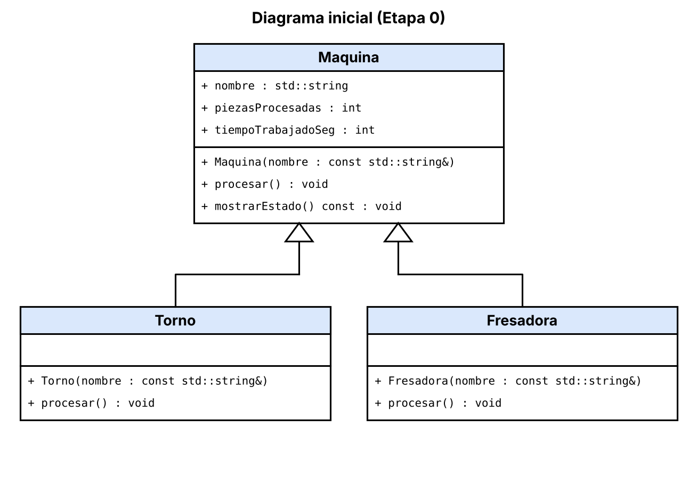

# Práctica Unidad IV: La evolución de una máquina

Programación Orientada a Objetos · Ingeniería Mecatrónica · Tercer semestre

Llena cada espacio conforme avances en las fases de [PRACTICA.md](PRACTICA.md).

## Fase 1. Entender el problema

**1.1 El problema con mis propias palabras**

En la planta hay una línea con varias máquinas: un torno, una fresadora, una pulidora, una estación de inspección y una banda transportadora. Todas procesan piezas en ciclos. De cada máquina hay que saber cómo se llama, cuántas piezas lleva, cuánto tiempo ha trabajado y cuánto tarda en hacer un ciclo. Con eso, la línea corre turnos y saca un reporte con las piezas, el tiempo y las piezas por hora de cada una. Lo difícil es que otros equipos van a crear máquinas nuevas usando mi clase Maquina, así que tengo que diseñarla de forma que no se pueda usar mal.

**1.2 Reglas que siempre deben cumplirse en una máquina** (escribe al menos tres)

El nombre no puede estar vacío.
Las piezas procesadas no pueden ser negativas.
El tiempo trabajado no puede ser negativo.
El tiempo de un ciclo tiene que ser mayor que cero, porque si es cero la capacidad por hora se divide entre cero y sale infinito.

**1.3 ¿Quién más usa la clase `Maquina`? ¿Qué podría salir mal si otro equipo crea una máquina nueva sin conocer tus reglas?**

La usan los otros equipos, que van a hacer sus propias máquinas a partir de ella, y también la parte que controla la línea y saca el reporte. Si alguien hace una máquina nueva sin conocer mis reglas, puede ponerle piezas o tiempo negativos, un ciclo de cero segundos o simplemente olvidarse de contar sus piezas. El programa compilaría bien, pero el reporte saldría con datos que no tienen sentido y nadie lo notaría.

## Fase 2. Diseñar la solución

**2.1 Diagrama inicial (Etapa 0)**

**2.2 Diagrama final (Etapa 9)**

**2.3 ¿Qué cambió entre los dos diagramas?**

| Elemento | Etapa 0 | Etapa 9 | Etapa que lo cambió |
| --- | --- | --- | --- |
| Visibilidad de los atributos de `Maquina` | _____ | _____ | _____ |
| `procesar()` | _____ | _____ | _____ |
| `tiempoCicloSeg()` | _____ | _____ | _____ |
| Destructor de `Maquina` | _____ | _____ | _____ |
| ¿Se pueden crear objetos `Maquina`? | _____ | _____ | _____ |
| Relación `ControlDeLinea` - `Maquina` | _____ | _____ | _____ |
| Relación `Torno` - `Motor` | _____ | _____ | _____ |
| Relación `BandaTransportadora` - `Motor` | _____ | _____ | _____ |

## Fase 3. Implementar

**3.0 Etapa 0. Una máquina sin reglas**

a) ¿Qué imprime ejecutarTurno() para el torno y la fresadora? ¿Por qué no imprime “torneando” ni “fresando”?

Imprime “procesamiento generico” para las dos. Esto pasa porque ejecutarTurno() recibe la máquina como Maquina&, y procesar() no es virtual. Entonces el compilador decide qué método llamar según el tipo declarado de la variable (Maquina) y no según el tipo real del objeto (Torno o Fresadora). A esto se le llama enlace estático.

b) ¿Por qué el torno acumula 65 s y no 135 s?

Porque solo la llamada directa usó Torno::procesar(), que suma 45 s. Los otros dos ciclos pasaron por ejecutarTurno() y usaron Maquina::procesar(), que suma 10 s cada uno. Entonces 45 + 10 + 10 = 65. Si hubiera usado el método del torno las tres veces, serían 45 × 3 = 135.
**3.1 Etapa 1. Invariantes y constructores explicit**

a) ¿Qué regla de la sección 1.2 rompió torno.piezasProcesadas = -5;?

Rompió la regla de que las piezas procesadas nunca pueden ser negativas. Como el atributo era público, cualquiera podía cambiarlo directo y nada lo detuvo.

b) ¿De dónde salió la máquina “Fantasma”? ¿Qué hizo el compilador sin que se lo pidieras?

imprimirFicha() pide una Maquina, y yo le pasé un std::string. Como el constructor de Maquina recibe un solo string, el compilador lo usó solo para convertir “Fantasma” en una Maquina temporal. Hizo esa conversión automática sin que yo lo pidiera.

c) ¿Qué tuviste que cambiar en Torno y Fresadora y por qué?

Ya no pueden modificar directamente nombre, piezasProcesadas ni tiempoTrabajadoSeg, porque ahora son privados. Cambié el código para que usen getNombre() para leer el nombre, y registrarPieza() y agregarTiempo() para actualizar los contadores. También puse explicit en sus constructores para que no haya conversiones automáticas.

**3.2 Etapa 2. Virtual y override**

a) La fresadora acumula 180 s, pero reporta 360 pzas/h. ¿Por qué un cálculo usó 60 s y el otro 10 s?

En la fresadora escribí int tiempoCicloSeg() sin const, y en Maquina es int tiempoCicloSeg() const. El const es parte de la firma, así que eran dos métodos distintos y el de la fresadora no sobrescribía al de la base. procesar() usaba la versión de la fresadora (60 s). Pero mostrarEstado() es const, así que solo podía llamar a la versión const de la base (10 s) para calcular la capacidad. Por eso el mismo objeto usó dos tiempos distintos.

b) ¿Tu compilador mostró alguna advertencia antes de usar override? ¿Qué mensaje dio después de agregar override?

Sí. El compilador mostró la advertencia 'virtual int Maquina::tiempoCicloSeg() const' was hidden, que ya me avisaba que el método de la fresadora estaba ocultando al de la base. Después de agregar override dio el error 'int Fresadora::tiempoCicloSeg()' marked 'override', but does not override. Corregí el const en el .h y en el .cpp y el error desapareció.

**3.3 Etapa 3. La línea de producción**

a) ¿Por qué la línea procesó todo como “generico” si procesar() ya es virtual?

Porque la línea guardaba las máquinas en un std::vector<Maquina>, o sea por valor. Al guardar un Torno o una Fresadora ahí se copia solo la parte Maquina y se pierde la parte derivada. A eso se le llama slicing. Ya dentro del vector eran Maquina de verdad, así que procesar() ejecutaba la versión de la base. El enlace dinámico solo funciona con punteros o referencias a la base.

b) ¿Por qué el torno y la fresadora originales quedaron con 0 piezas?

Porque agregar() recibía una copia. La línea trabajó con sus propias copias dentro del vector, y los objetos originales de main nunca se tocaron.

c) La relación entre ControlDeLinea y Maquina, ¿es composición o agregación? ¿Por qué?

Es agregación. La línea solo guarda punteros a máquinas que ya existen fuera de ella. No las crea ni las destruye, y por eso nunca hace delete. Si la línea desaparece, las máquinas siguen existiendo en la planta.

**3.4 Etapa 4. Destructores**
Momento	Mensajes de destrucción que aparecieron
delete temporal; sin destructor virtual	Destruyendo Maquina
delete temporal; con destructor virtual	Destruyendo Torno, Destruyendo Motor, Destruyendo Maquina
Al terminar main (torno y fresadora)	Destruyendo Maquina (la fresadora), luego Destruyendo Torno, Destruyendo Motor, Destruyendo Maquina (el torno)

aa) ¿Qué advertencia mostró el compilador? ¿Por qué decimos que ya te estaba avisando del problema?

Mostró deleting object of polymorphic class type 'Maquina' which has non-virtual destructor might cause undefined behavior. Ya me estaba avisando porque el programa compilaba, pero el aviso decía justo lo que iba a pasar: al borrar un Torno a través de un puntero a Maquina sin destructor virtual, solo se destruía la parte Maquina y el Torno y su Motor nunca se destruían.

b) ¿Por qué el torno de main sí se destruyó completo aunque el destructor no fuera virtual? ¿A qué máquina corresponde el primer “Destruyendo Maquina” después de “Fin de main”?

Porque torno es una variable local de tipo Torno, y el compilador conoce su tipo real, así que llama directo al destructor de Torno, que luego destruye su Motor y después la base. En cambio, con delete temporal el tipo declarado era Maquina* y, sin virtual, el compilador solo llamó al destructor de Maquina. El primer “Destruyendo Maquina” después de “Fin de main” es de la fresadora, porque los objetos locales se destruyen en orden inverso a su creación, y la fresadora se creó después del torno. Ella solo tiene el destructor de la base, porque no tiene motor.

**3.5 Etapa 5. La clase abstracta**

a) (Pega aquí los mensajes de error que te salieron.) El primer error dice que no se puede crear pulidora porque Pulidora es abstracta: le falta implementar procesar(), que en Maquina es virtual puro. El segundo dice que no se puede crear generica porque Maquina misma es abstracta, ya que tiene procesar() y tiempoCicloSeg() virtuales puros. Las líneas note: explican el porqué: qué métodos puros siguen sin implementar.

b) Antes, la pulidora no pulía y una “máquina sin tipo” produjo piezas, y el reporte salía mal sin que nadie se diera cuenta. Ahora el compilador no deja crear una máquina sin tipo ni una máquina concreta a la que le falte procesar(). El error aparece al compilar, antes de que el programa llegue a la planta.

**3.6 Etapa 6. El contrato que el compilador no ve**

a) Violó dos partes del contrato. procesar() no llamó a registrarPieza() ni a agregarTiempo(), así que sus piezas y su tiempo se quedaron en cero. Y tiempoCicloSeg() devolvió 0, cuando el contrato dice que siempre debe ser mayor que cero. Por eso la capacidad por hora se calculó como 3600 entre 0 y salió infinita.

b) Porque el compilador solo revisa la forma del contrato: nombres, parámetros y tipos. Todas las firmas de InspeccionVisual eran correctas. Lo que se rompió fue el significado de lo que promete la base, y eso el compilador no lo puede ver.

c) Pasaría lo mismo: su máquina compilaría sin problemas y el reporte saldría con datos absurdos, como piezas en cero o capacidad infinita, sin que nadie lo notara. Un comentario depende de que cada equipo lo lea y lo respete. La Etapa 7 lo resuelve haciendo que la base cumpla el contrato por ellos.

**3.7 Etapa 7. La base hace cumplir el contrato**

a) ¿Cómo puede una clase derivada sobrescribir un método que es privado en la base?

[Inserta aquí tu respuesta]

b) ¿Qué ocurre ahora con una máquina cuyo tiempo de ciclo es 0? Compáralo con la Etapa 6.

[Inserta aquí tu respuesta]

c) ¿Por qué la línea ignoró el "atajo" del torno, pero la llamada directa no? ¿Cómo corregiste el diseño?

[Inserta aquí tu respuesta]

**3.8 Etapa 8. Herencia mal usada**

a) Da al menos dos razones por las que `BandaTransportadora : public Motor` es un error de diseño.

[Inserta aquí tu respuesta]

b) La relación entre `BandaTransportadora` y `Motor`, ¿es composición o agregación? ¿Por qué?

[Inserta aquí tu respuesta]

**3.9 Etapa 9. La librería y la prueba final**

a) Después de agregar la `Cortadora`, ¿qué archivos mostró `git status`? ¿Cuántos archivos de la librería tuviste que modificar?

[Inserta aquí tu respuesta]

b) ¿Qué pasó al escribir `-lplanta` antes de `src/main.cpp`? ¿Por qué?

[Inserta aquí tu respuesta]

**3.10 Bitácora de dudas**

| # | Etapa | Duda | Cómo la resolví | Fuente |
| --- | --- | --- | --- | --- |
| 1 | _____ | _____ | _____ | _____ |
| 2 | _____ | _____ | _____ | _____ |
| 3 | _____ | _____ | _____ | _____ |

## Fase 4. Probar y mejorar

**4.1 Tabla de pruebas**

| # | Caso | Resultado esperado | Resultado obtenido | ¿Pasa? |
| --- | --- | --- | --- | --- |
| 1 | Máquina con nombre vacío | Excepción con mensaje claro | _____ | _____ |
| 2 | Reporte de una línea vacía | "La linea no tiene maquinas" | _____ | _____ |
| 3 | `agregar(nullptr)` | Devuelve `false` | _____ | _____ |
| 4 | Reporte antes de ejecutar el turno | 0 piezas, 0 s y capacidad calculada | _____ | _____ |
| 5 | Turno de 0 ciclos | Nada cambia | _____ | _____ |
| 6 | Torno con 3 ciclos | 3 piezas, 135 s, 80 pzas/h | _____ | _____ |
| 7 | Máquina con `tiempoCicloSeg()` igual a 0 | Excepción con mensaje claro | _____ | _____ |
| 8 | Máquina con `tiempoCicloSeg()` negativo | Excepción con mensaje claro | _____ | _____ |
| 9 | La misma máquina agregada dos veces | _____ | _____ | _____ |

**4.2 Bitácora de mejoras**

| # | Falla o mejora detectada | Qué cambié | Por qué |
| --- | --- | --- | --- |
| 1 | _____ | _____ | _____ |
| 2 | _____ | _____ | _____ |

Retos opcionales que intenté: _____

## Fase 5. Publicar en GitHub

**5.1 Enlace a mi fork**

[Inserta aquí el enlace a tu fork]

## Cierre y reflexión

**6.1 Errores que ya no pueden ocurrir**

| Error | Etapa en que apareció | Restricción que lo impide ahora | ¿Quién lo detecta: el compilador o el programa? |
| --- | --- | --- | --- |
| Contadores con valores inválidos | _____ | _____ | _____ |
| Máquina "fantasma" creada a escondidas | _____ | _____ | _____ |
| Método que no sobrescribe por un `const` | _____ | _____ | _____ |
| Máquinas copiadas y "rebanadas" | _____ | _____ | _____ |
| Destrucción incompleta | _____ | _____ | _____ |
| Máquina sin `procesar()` propio | _____ | _____ | _____ |
| Tiempo de ciclo inválido | _____ | _____ | _____ |
| Derivada que no registra sus piezas | _____ | _____ | _____ |

**6.2 ¿Cuál de los errores fue el más peligroso: el de compilación, la advertencia o el que compilaba sin problemas? ¿Por qué?**

[Inserta aquí tu respuesta]

**6.3 ¿Qué aprendiste en esta práctica?**

[Inserta aquí tu respuesta]

**6.4 ¿Qué cambiarías de tu proceso la próxima vez?**

[Inserta aquí tu respuesta]
